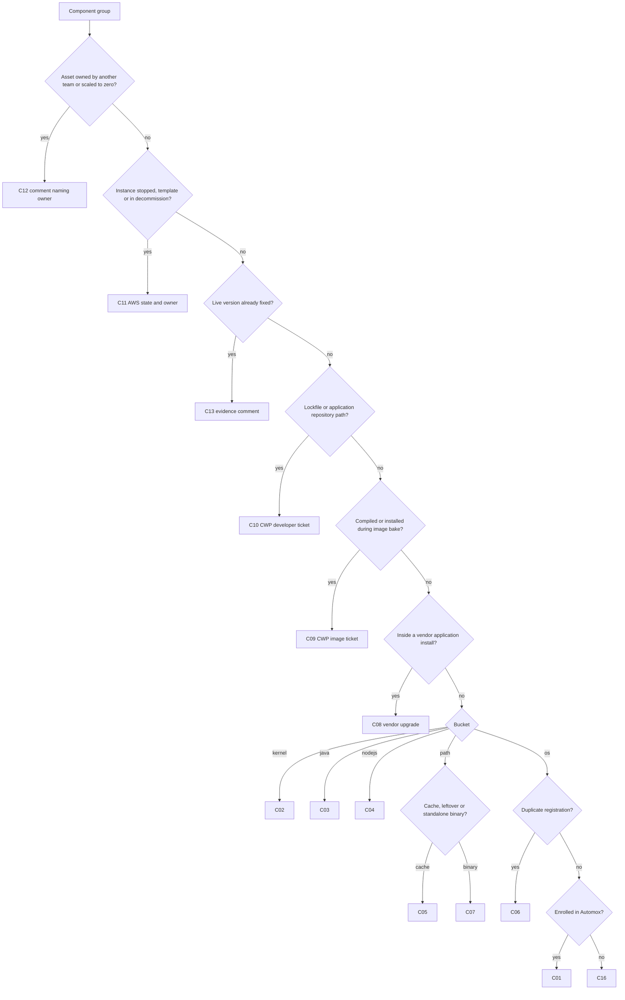

# Classification of Vulnerability Findings

Classify per asset and per component group (one `analysis.json` component entry). One asset usually carries several classes. The `categorize.py` bucket is the first signal; the evidence column decides.

## Contents

- [Class table](#class-table)
- [Class details](#class-details)
- [Decision order](#decision-order)

## Class table

| ID | Class | Bucket | Owner | Typical outcome |
|---|---|---|---|---|
| C01 | OS packages on an Automox-enrolled host | os | DevOps via Automox | Closing comment: enrolled, policies named |
| C02 | Kernel installed, reboot pending | kernel | DevOps via Automox | Reboot Worklet in an allowed window, or comment |
| C03 | Java runtimes | java | DevOps | Corretto upgrade or removal, service restart in window |
| C04 | End-of-life runtimes | nodejs, os | DevOps | Supported major (nodejs22 Worklet) or binary swap |
| C05 | Stale caches and leftovers | path | DevOps | Delete with process guard |
| C06 | Duplicate RPM registrations | os | DevOps | `rpm -e --test`, remove duplicate |
| C07 | Third-party binaries | path | DevOps | Checksum-verified binary Worklet |
| C08 | Vendor-bundled application libraries | path | DevOps (DEVOPS ticket) | Vendor upgrade; no ad-hoc jar swap |
| C09 | Image-baked software | path | Image owner (CWP ticket) | Image change, AMI bake, ASG refresh by owner |
| C10 | Application dependency lockfiles | path | Developers (CWP ticket) | Dependency bump in the repository |
| C11 | Stopped template or decommission | any | DevOps / owner | AWS state recheck, decommission ticket |
| C12 | Scaled to zero or not our layer | any | Other team | Comment naming the owner; no change |
| C13 | Already fixed (scan lag) | any | DevOps | Live version check, comment with evidence |
| C14 | On-premises configuration (Brinqa) | n/a | DevOps | Config change with configtest and rollback |
| C15 | Jenkins service start timeout | n/a | DevOps | `TimeoutStartSec=300` drop-in |
| C16 | Host not enrolled in Automox | any | DevOps | Enrol, or record why it cannot be enrolled |

## Class details

### C01 OS packages on an Automox-enrolled host

- Signals: `os` bucket, RPM names (`openssl-libs`, `rsync`, `systemd-libs`, `rpm-libs`).
- Evidence: `automox_map.py` status `enrolled` joined by SERVICETAG; group ID and policy names; `device-packages` pending list; policy schedule and time zone.
- Outcome sentence: the machine is enrolled in Automox and undergoes the named policies. Do not claim the patching fixes findings it does not cover.
- Session: SCTASK1658128 (VAFALARTIFACTORY), SCTASK1782160 (vafpfcache-template, CUE-PROD-UPDATE and CUE-PROD-RELEASE-UPGRADE).

### C02 Kernel installed, reboot pending

- Signals: `kernel` bucket (`kernel`, `kernel-tools`, `kernel6.18`), Automox `needs_reboot=true`, running kernel older than newest installed.
- Evidence: `uname -r` against `rpm -q kernel | sort -V | tail -1`; policy auto_reboot flags (987485 and 987483 run Friday, one of them in UTC).
- Constraints: Jenkins hosts reboot only outside 07:00-19:00. Artifactory is never restarted for a kernel; it reboots when it reboots.
- Session: SCTASK1782187 (VAFJENKINSOS, Worklet `al2023-kernel-reboot`), VAFALCUEJENKINS reboot on 3 Nov followed by C15.

### C03 Java runtimes

- Signals: `java` bucket, `java-<n>-amazon-corretto*`, Temurin paths.
- Evidence: the JDK the service actually runs (`readlink -f /proc/<MainPID>/exe`), alternatives, installed Corretto packages.
- Session: Jenkins hosts moved to Corretto 25 with old Corretto 17 and 21 removed (vafjenkinsos, vafcuejenkins, krarapjgithub).

### C04 End-of-life runtimes

- Signals: `nodejs` bucket, Node.js 18 packages, `/usr/local/bin/node` binaries.
- Evidence: `rpm -qa 'nodejs*'`, `node -v`, which jobs use node, glibc compatibility for binary swaps.
- Session: SCTASK1778335, SCTASK1778367, SCTASK1778373 (Worklets `*-nodejs22`: install nodejs22, `rpm -e --test`, remove nodejs 18, `alternatives --auto node`, minimum version check).

### C05 Stale caches and leftovers

- Signals: `path` bucket under `jarCache`, `.m2`, `scratch`, old WARs, unpacked installers, old log4j jars.
- Evidence: file owner and age, whether any running process maps the file, whether the cache regenerates.
- Session: SCTASK1728131, SCTASK1728157, SCTASK1741564, SCTASK1741578 (VAFPBJENT jar cache cleared), java-cleanup Worklets.

### C06 Duplicate RPM registrations

- Signals: one package reported twice with two versions (for example `less`).
- Evidence: `rpm -q <pkg>` returns two versions; `rpm -e --test` on the older one.
- Session: SCTASK1661494.

### C07 Third-party binaries

- Signals: `path` bucket under `/usr/local/bin` or vendor directories: argocd, docker-compose, Splunk UF, Allure.
- Evidence: `<bin> --version`, upstream release with published checksum.
- Session: argocd CLI 3.5.4 Worklet (`sha256sum -c`), orphaned Allure 2.13.5 removed on VAFALCUEJENKINS, SCTASK1730625.

### C08 Vendor-bundled application libraries

- Signals: `path` bucket inside an application install (Artifactory Tomcat, Spring Security, Freemarker; Jenkins core and plugins such as bouncycastle-api).
- Evidence: installed application version, vendor release notes mapping bundled versions (JFrog embedded Tomcat table), plugin manager state.
- Constraints: Artifactory is never restarted by this workflow; its upgrade is a DEVOPS ticket with rollback. Jenkins restarts follow the C02 window.
- Session: DEVOPS-838, DEVOPS-855 (SCTASK1698769, target re-check 7.146.38 to 7.146.45), VAFALCUEJENKINS bouncycastle-api 2.30.1.86.1.

### C09 Image-baked software

- Signals: `path` bucket for binaries compiled in the image (`/usr/sbin/nginx`, varnish, `amazon-ssm-agent` on ASG members); Asset ID is an ASG ARN; `Image External ID` present.
- Evidence: launch template AMI and build date, image repository pin (`gh api`), live version on a current instance, whether a newer AMI exists.
- Constraints: no ASG refresh on a live group by this workflow; replacing instances with the current image does not remediate.
- Session: SCTASK1782401 and SCTASK1778379 (ASG_VAFS2FNGX nginx 1.31.3), CWP-15193, CWP-15519, CWP-15680, PR #83 in TVN-zoltan-edgecache, ASG_VAFPFVAR2 ssm-agent scope extension.

### C10 Application dependency lockfiles

- Signals: `path` bucket ending in `package-lock.json`, `yarn.lock`, `pom.xml`, `go.sum`, often under an application checkout on a host.
- Evidence: repository and commit that produced the file (`gh api`), resolved versions, minimum fixed versions per library.
- Outcome: CWP developer ticket under epic CWP-15484 with libraries only; host, Automox and rescan work stay out of the ticket.
- Session: SCTASK1782160 and SCTASK1756593 (TVN-CUE-migration-toolkit, CWP-15520), CWP-14912, CWP-15087.

### C11 Stopped template or decommission

- Signals: `-template` asset names, assets in migration tickets.
- Evidence: AWS `describe-instances` state and state transition time, tags (`TEMPLATE`, `BACKUP`, `OWNER`), Terraform presence, migration ticket status.
- Rule: decommission is stated only when the owner or a ticket says so.
- Session: SCTASK1778375, ASG_VAFPBCUEUM (CWP-15517 EKS cutover), VAFS1FCAEN-template, VAFBENGPENT1-template (old instance terminated).

### C12 Scaled to zero or not our layer

- Signals: Varnish layer (VAFFVARS1, VAFFVARS2), ADTECH and ADPOD hosts, ASGs with desired capacity 0.
- Evidence: ASG desired capacity, owner confirmation in the session or ticket.
- Session: SCTASK1658168 (scaled to zero), SCTASK1661470, SCTASK1661492, SCTASK1661507 (not our layer).

### C13 Already fixed (scan lag)

- Signals: `Last found` older than the remediation, host already on the fixed version.
- Evidence: live version (`rpm -q`, `<bin> --version`, Worklet output) after the fix date.
- Session: SCTASK1756649, SCTASK1782187.

### C14 On-premises configuration (Brinqa)

- Signals: Brinqa or Tenable report for on-premises hosts: HTTP TRACE enabled, ICMP timestamp replies, PHP 8.3 patch level, JDK 11 on EL7, RHEL repositories.
- Evidence: config files, `apachectl configtest`, package repositories, OS lifecycle.
- Session: Brinqa report of 76 findings on 8 hosts, TRACE fix Worklet with configtest rollback.

### C15 Jenkins service start timeout

- Signals: no scanner row; appears after a restart for C02, C03 or C08. Jenkins stuck in 502/503 with systemd `NRestarts` growing.
- Evidence: `systemctl show jenkins -p TimeoutStartUSec -p NRestarts`, journal "Jenkins is fully up and running" timing against 90 s.
- Session: vafcuejenkins on 23 Oct, 31 Oct and 3 Nov; Worklet `jenkins-timeoutstart-300`.

### C16 Host not enrolled in Automox

- Signals: `automox_map.py` status `not-enrolled` or `asg-unresolved` for a long-lived instance.
- Evidence: SERVICETAG search over all devices, ssm-agent and Automox agent presence, whether the host is long-lived.
- Session: ASG_VAFPBCUEUM instance not in Automox, VAFALDEVPREVDEM01 enrolment check (SCTASK1782306).

## Decision order

When one component group matches several classes, take the first match:

C14 applies to Brinqa on-premises reports, C15 to any Jenkins restart performed for another class.
