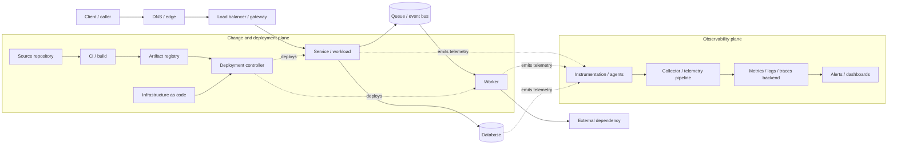

# Architecture Mapping for Incident Investigation

## Objective

Create a verified model of the components and boundaries that can explain the observed symptom. The diagram is an investigation artifact, not decoration. It should help locate the first failing boundary and reveal shared dependencies, failure propagation, and blast radius.

## Discovery order

Use sources in roughly this order, but prefer the most current authoritative source available:

1. Live runtime state and cloud inventory (read-only): workloads, services, endpoints, ingress/gateway routes, nodes, regions/AZs, managed services, load balancers, queues, databases, and network boundaries.
2. Deployment and infrastructure definitions: Terraform/IaC, Helm/Kustomize, Kubernetes manifests, deployment controllers, CI pipelines, image/artifact references, and environment configuration.
3. Service catalog, ownership metadata, runbooks, architecture docs, and operational dashboards.
4. Distributed traces and logs showing real request paths, callers, callees, queue producers/consumers, and external calls.
5. Engineer-provided context. Treat unverified descriptions as hypotheses until corroborated.

Be alert to drift between declared and live state. Record which source supports each material edge or component.

## Diagram layers

Show only layers relevant to the incident, but consider all of these:

- **Entry/edge:** user/client, DNS, CDN, WAF, load balancer, ingress, API gateway.
- **Application/data plane:** API services, workers, scheduled jobs, internal RPC/HTTP calls, event streams, queues, caches, databases, object storage, external APIs.
- **Runtime/platform:** cluster, namespace, deployment, pod/workload, node group, region/AZ, service mesh, network path.
- **Control plane/change path:** source repository -> CI/build -> artifact registry -> IaC/deployment controller -> runtime rollout.
- **Observability plane:** instrumentation/agent -> collector/forwarder -> telemetry backend -> alert/dashboard/on-call notification.
- **Security/trust boundaries:** identity provider, secrets/config store, IAM boundary, network boundary, tenant boundary. Never expose secret values.

Distinguish a request path from the mechanisms that deploy or observe it. Do not draw the CI pipeline as though it handles user traffic.

## Mermaid template

Replace all generic labels with observed names. Remove components that do not exist. Add `unknown` nodes or dashed edges where a relationship is not verified.

The template is illustrative only. It must not be reported as the incident's actual architecture until verified.

## Diagram quality checklist

- [ ] User or job entry point and the affected operation are identified.
- [ ] The complete synchronous request path is shown.
- [ ] Relevant asynchronous producers, queues, consumers, and retry/dead-letter paths are shown.
- [ ] Data stores and important shared dependencies are shown.
- [ ] Runtime, region/AZ, and network boundaries relevant to the blast radius are identified.
- [ ] Control plane is visually separate from the live data plane.
- [ ] Observability path is shown when telemetry quality or missing signals matter.
- [ ] Protocols, timeouts, retries, and ownership are included only when verified.
- [ ] Unknown or inferred links are visibly marked.
- [ ] The failing boundary and affected path are highlighted in the written explanation; do not rely only on color.

## Architecture questions

For every component on the affected path, ask:

- What is its role, owner, runtime location, and deployment unit?
- What calls it, and what does it call? Is the edge synchronous or asynchronous?
- What are its timeout, retry, concurrency, pool, queue, and resource limits?
- Is it shared across tenants, regions, services, or critical workflows?
- What is its health signal, and can the telemetry path itself fail?
- What changed recently in its code, config, dependencies, infrastructure, or data?
- What is the smallest healthy comparison path (other AZ, region, version, tenant, endpoint, or dependency)?

## Architecture-aware failure localization

Trace the affected operation from entry to completion. Find the earliest point where behavior differs from a healthy request/job. A downstream timeout may be a symptom of an upstream stall; a service reporting healthy may still be unable to complete a dependency call. Check both caller and callee evidence around the same trace/request IDs and time interval.
